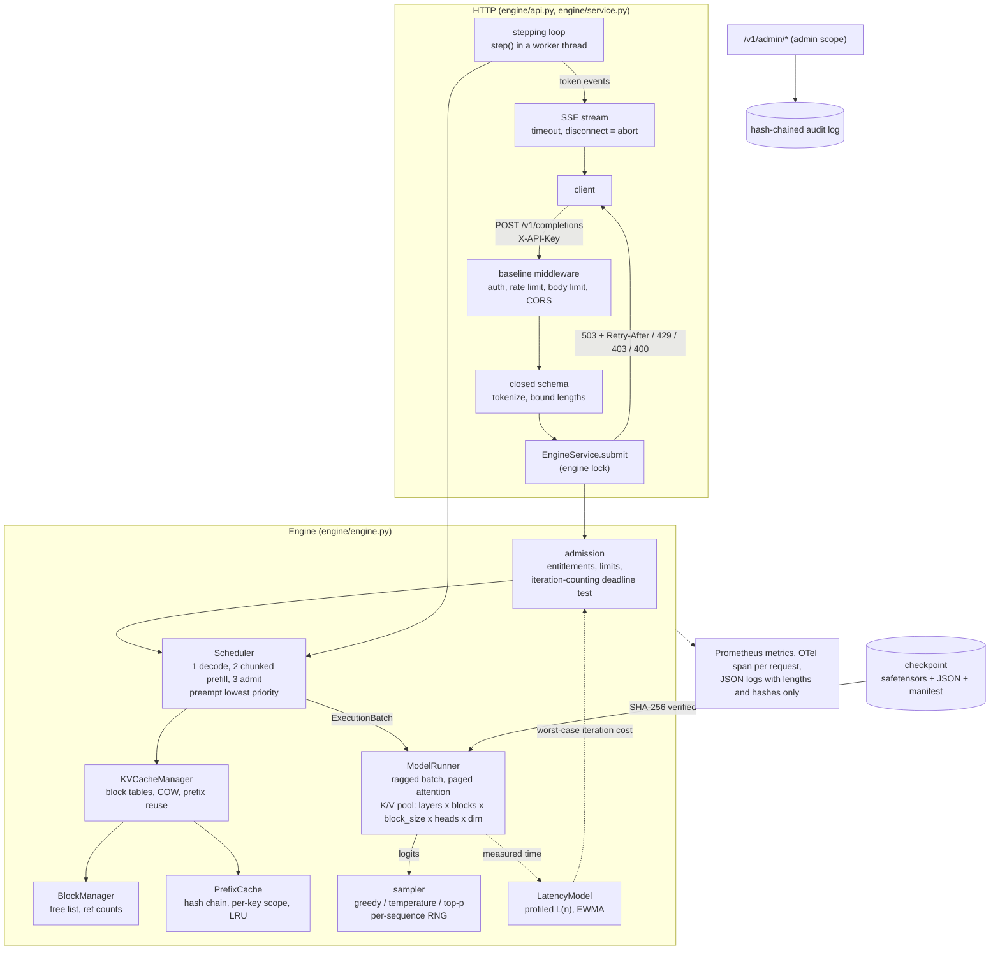

# paged-kv-serving

A from-scratch CPU inference engine for a tiny transformer: a paged KV cache with reference-counted
copy-on-write blocks, iteration-level continuous batching with chunked prefill and preemption,
hash-chained block prefix caching, and deadline-aware admission control, served over SSE and
measured against a static-batching baseline that shares the same model code.

Everything runs offline on a CPU in float32 NumPy. The model has random weights on purpose: the
claim is that the engine computes exactly what a naive recompute computes, and how much faster it
schedules the same work, not that the text means anything.

## Problem

Serving an autoregressive model is a scheduling and memory problem before it is a compute problem.

- **Static batching** runs a fixed group until its longest member finishes. Short requests wait
  for long ones, every prompt is padded to the longest in its batch, and a request that arrives
  just after a batch starts waits for the whole batch (head-of-line blocking).
- **Contiguous KV caches** reserve a maximum-length region per sequence. Most of it is never used,
  and what is used fragments.
- **Servers that accept every request** under a burst do not serve more; they turn every request
  into a timeout while still spending memory on answers nobody will wait for.

The mechanisms that fix these (PagedAttention, continuous batching, chunked prefill, prefix
caching, admission control) are what LLM serving engines are built from. This repository
implements them directly, tests them against a dense reference, and measures them.

## What is implemented

| Mechanism | Where | How it is checked |
|---|---|---|
| Paged KV cache: fixed-size blocks, block tables, FIFO free list, reference counts, copy-on-write, leak checker | `engine/blocks.py`, `engine/kvcache.py` | hypothesis stateful machine over admit/prefill/decode/fork/preempt/free/evict |
| Paged attention over non-contiguous blocks with an online softmax | `engine/attention.py`, `engine/runner.py` | property tests against dense attention |
| Iteration-level continuous batching: decode first, then chunked prefill, then admission in (SLO class, deadline, arrival) order | `engine/scheduler.py` | unit tests plus engine-level logit equivalence |
| Preemption by recomputation of the lowest-priority unscheduled sequence | `engine/scheduler.py` | token-for-token and logit-for-logit equivalence under a cramped pool |
| Block prefix cache keyed by `hash(parent_hash, block tokens)`, per-key scope, LRU eviction of unreferenced blocks | `engine/prefix_cache.py` | chain, scope and eviction unit tests; TTFT benchmark |
| Parallel sampling (`n`) sharing the prompt's blocks | `engine/engine.py` | shared prefill counted, divergence tested |
| Deadline-aware admission: iteration-counting feasibility test, profiled latency model with EWMA correction, early 503 with `Retry-After` | `engine/admission.py` | fake-clock simulation: zero admitted misses |
| Lower-class prefill allowance protecting interactive decode steps from batch floods | `engine/scheduler.py` | adversarial workload tests |
| Per-key entitlements: SLO classes, tokens/minute, concurrency, prompt and output ceilings | `engine/keys.py` | unit and API tests |
| FastAPI `/v1/completions` with SSE streaming, request timeouts, cancellation on disconnect, graceful drain | `engine/api.py`, `engine/service.py` | API tests, including a real loopback server |
| Static-batching baseline over the same runner and sampler | `engine/static.py` | used by the benchmarks and the demo |
| Open-loop load generators (in-process and HTTP) free of coordinated omission | `engine/loadgen.py`, `engine/http_loadgen.py` | schedule-not-completion tests |
| safetensors checkpoint with a SHA-256 manifest, in-repo byte-level BPE tokenizer | `engine/weights.py`, `engine/tokenizer.py` | tamper and pin tests |

The scheduling and memory logic is described step by step in [docs/SCHEDULER.md](docs/SCHEDULER.md).

## Architecture



One iteration: the scheduler builds a ragged batch under a token budget (decode tokens of running
sequences first, then prefill chunks, then new admissions), reserving blocks and preempting if the
pool runs dry; the runner writes each token's keys and values into its block-table slot and runs
paged attention per sequence; every slice that reaches the end of its sequence samples one token
with that sequence's own generator; newly full blocks are published to the prefix cache; finished
sequences release their blocks. Benchmarks drive the same engine without HTTP.

## Quickstart

Requirements: [uv](https://docs.astral.sh/uv/) and Python 3.12. No GPU, no model download, no API
key.

```bash
uv sync --frozen
uv run python tasks.py demo      # offline end-to-end demo (about 10 s)
uv run python tasks.py test      # pytest with coverage
uv run python tasks.py bench     # micro-benchmarks + serving comparison, with thresholds
uv run python tasks.py check     # lint, typecheck, test, audit, baseline
```

The demo builds a checkpoint, checks logit equivalence through the real scheduler, measures the
prefix cache, refuses an infeasible burst, cancels a request, compares continuous and static
batching on one arrival schedule, then starts the server on a loopback port, streams over SSE,
hangs up mid-stream and sends an open-loop burst of interactive and batch traffic from two keys.

Serving it yourself:

```bash
uv run paged-kv-serving build-checkpoint --out var/checkpoint     # prints manifest_sha256
uv run paged-kv-serving generate-api-key                          # prints api_key + digest
export APP_API_KEY_SHA256=<digest>
export APP_KEY_POLICIES="<digest>:interactive|batch:60000:8:512:128:1"
export APP_CHECKPOINT_MANIFEST_SHA256=<manifest_sha256>           # refuse a swapped checkpoint
uv run paged-kv-serving serve
curl -N localhost:8000/v1/completions -H "X-API-Key: <api_key>" \
  -H "Content-Type: application/json" \
  -d '{"prompt": "Why reject early?", "max_tokens": 16, "stream": true, "deadline_ms": 2000}'
```

A key policy is
`<sha256>:<classes>:<tokens/min>:<max concurrent sequences>:<max prompt>:<max new>:<admin>[:<max n>]`;
an `n`-way request counts `n` sequences against the concurrency cap and is charged
`prompt + n * max_new_tokens`, and `n` above the key's limit (default 1) is a 400.
Every setting is listed in [.env.example](.env.example). `docker compose up --build` runs the
server and an open-loop load generator against it; the generator reads raw keys from
`LOADGEN_INTERACTIVE_API_KEY` and `LOADGEN_BATCH_API_KEY` in your shell or `.env` (the compose
file documents the variables).

## Results

All numbers below were produced on one machine: Windows 10, Intel Core i5-8500 (6 cores), CPython
3.12.14, NumPy 2.5.3, OpenBLAS pinned to one thread (docs/adr/0006-single-threaded-blas.md). The
model is the 820,352-parameter demo checkpoint (4 layers, `d_model` 128, vocabulary 512). Python
and NumPy overhead dominate absolute speed, so only ratios between the two schedulers on the same
machine are claimed. Full JSON output is in `bench/results/`; `serving.json` embeds a run
manifest with the checkpoint seed, package versions and the SHA-256 of every checkpoint file.

### Continuous vs static batching

`uv run python bench/bench_serving.py --check` (21.8 s). Both engines get the same KV memory (4,096
tokens: the paged pool, or 16 static slots of 256 tokens), the same model and sampler, and the
same Poisson arrival schedule at each load point. Load is relative to capacity measured first
(74.82 requests/s, continuous engine saturated). 48 requests per point, each interactive with
probability 0.5 (29 of the 48) with a 1 s deadline; latency is measured from the scheduled arrival
(open loop). Times are in seconds.

| load | scheduler | completed | rejected | tokens/s | TTFT p50 | TTFT p99 | latency p99 | SLO | goodput/s |
|---|---|---:|---:|---:|---:|---:|---:|---:|---:|
| 0.5x | continuous | 48 | 0 | 715.75 | 0.0085 | 0.0511 | 0.1945 | 1.0 | 24.948 |
| 0.5x | static | 48 | 0 | 513.79 | 0.3634 | 0.6685 | 0.9229 | 1.0 | 17.909 |
| 1x | continuous | 48 | 0 | 1204.65 | 0.0268 | 0.0927 | 0.3966 | 1.0 | 41.989 |
| 1x | static | 48 | 0 | 510.96 | 0.5262 | 0.9655 | 1.2515 | 0.6897 | 12.283 |
| 1.5x | continuous | 48 | 0 | 1150.35 | 0.0463 | 0.3157 | 0.5056 | 1.0 | 40.096 |
| 1.5x | static | 48 | 0 | 564.91 | 0.574 | 0.9877 | 1.2216 | 0.6897 | 13.58 |
| 3x | continuous | 48 | 0 | 1158.05 | 0.1154 | 0.4472 | 0.6159 | 1.0 | 40.365 |
| 3x | static | 48 | 0 | 573.6 | 0.6624 | 1.1039 | 1.3248 | 0.6897 | 13.789 |

| continuous / static | 0.5x | 1x | 1.5x | 3x |
|---|---:|---:|---:|---:|
| goodput (on-time completions per second) | 1.39 | 3.42 | **2.95** | 2.93 |
| output tokens per second | 1.39 | 2.36 | 2.04 | 2.02 |
| TTFT p99 (static / continuous) | 13.1 | 10.4 | 3.13 | 2.47 |

The spec's target was goodput at least 1.5x static at 1.5x load; measured 2.95x. From 1x load
upwards static batching misses the 1 s deadline for 31% of interactive requests, while the
continuous engine meets every one. Absolute numbers move by several percent between runs on this
machine (an earlier run of the same command measured 2.64x at 1.5x); CI fails if the 1.5x or 3x
goodput ratio drops below 1.5.

### Prefix cache

Same command. 20 requests sharing a 128-token system prompt plus a 16-48-token user turn, one key,
well below capacity so TTFT measures prefill rather than queueing:

| | cache off | cache on |
|---|---:|---:|
| TTFT p50 (s) | 0.01642 | 0.00467 |
| prefill tokens computed | 3169 | 737 |
| block hit ratio | 0.0 | 0.8128 |

TTFT p50 reduction **71.6%** (target at least 30%); prefill tokens saved 76.7%. The token counts
are deterministic; the TTFT reduction varies with timing noise (61.9% in an earlier run).

### KV memory

Same command. 24 requests submitted at once, prefix cache off:

| | value |
|---|---:|
| paged: tokens resident / tokens in allocated blocks, mean over iterations | 0.9331 (min 0.8889) |
| static: tokens in a batch at its end / reserved slot memory | 0.3348 |
| paged peak KV tokens allocated | 1392 |
| static KV tokens reserved | 4096 |

### Admission control (fake clock, exact latency model)

Same command. The executor consumes exactly the time the latency model predicts (2e-4 s per
token, about 45 requests/s of capacity), so the only thing measured is the admission test. 300
requests per load level, deadlines 0.75/1.5/3 s, run with admission and with admission effectively
off (a vanishing safety factor):

| load | admitted | refused at arrival | admitted that missed | on time (admission) | on time (accept all) | missed (accept all) |
|---|---:|---:|---:|---:|---:|---:|
| 0.5x | 287 | 13 | 0 | 287 | 300 | 0 |
| 1x | 277 | 23 | 0 | 277 | 300 | 0 |
| 2x | 187 | 113 | 0 | 187 | 197 | 103 |
| 4x | 126 | 174 | 0 | 126 | 113 | 187 |

No admitted request missed its deadline at any load. The test is deliberately pessimistic (every
iteration costed at a full budget, ADR 0004): at low load it refuses requests that would have
made it, and at 2x load accepting everything completes slightly more on time. What it buys is that
overload produces immediate, retryable refusals instead of requests that hold KV blocks and then
time out: at 4x, accept-all misses 187 of 300 deadlines.

### Correctness and micro-benchmarks

`uv run python bench/bench_baseline.py --check`:

| benchmark | runs | p50 (us) | p95 (us) | other |
|---|---:|---:|---:|---|
| block_allocate_free_16 | 5000 | 5.4 | 5.4 | |
| copy_on_write_block | 5000 | 1.8 | 1.9 | |
| prefix_hash_chain_512_tokens | 2000 | 137.9 | 146.2 | |
| paged_attention_decode_256ctx | 2000 | 131.6 | 153.1 | |
| sample_top_p_512_vocab | 5000 | 75.8 | 86.4 | |
| admission_decide_64_committed | 2000 | 77.9 | 89.0 | |
| engine_iteration_128_tokens | 20 | 11446.2 | 12447.1 | |
| engine_throughput_24_requests | 1 | | | 288 tokens in 0.178 s, 1616 tokens/s |
| paged_vs_reference_equivalence | 4 | | | max abs logit gap 2.444e-06 |
| engine_vs_reference_equivalence | 1 | | | max abs logit gap 3.189e-06 over 264 rows, 8 preemptions, 35 prefix-hit blocks |

The equivalence rows compare every logits row the engine sampled from (mixed prefill/decode
batches, chunk boundaries inside blocks, prefix-cache hits, recomputation after preemption,
forked samples) with a dense, cache-free recompute of the same sequence. CI fails if either gap
exceeds 1e-4 or if the scenario stops producing preemptions and prefix hits.

### Demo excerpt

`uv run python tasks.py demo` (same machine; timings vary between runs, and the served section
runs client and server in one process, so its HTTP latencies include GIL contention and are
illustrative only; the admission deadline is set to 40 profiled worst-case iterations):

```
equivalence: single-prompt max |dlogit| 2.21e-06; engine max |dlogit| 2.95e-06 over 165 rows with 1 preemptions
prefix cache: hit ratio 0.783, prefill tokens saved 75.1%, TTFT p50 reduction 50.5%
admission: 60 offered, 26 admitted, 34 refused early, 100% of admitted met the 0.234s deadline
cancellation: 6 blocks held -> 0 after abort; pool whole after cache flush: True
server: healthz 200, readyz ready, no key 401, batch key asking for interactive 403, hang-up aborted 1 request(s), sequence blocks after hang-up 0, audit verified True
http burst [batch]: sent 32, completed 17, errors {'key_concurrency': 15}, TTFT p50/p99 0.2444/0.9824s
http burst [interactive]: sent 28, completed 28, errors {}, TTFT p50/p99 0.2308/0.96s

continuous vs static batching (same arrivals, same model):
label       completed  tokens_per_second  ttft_p50  ttft_p99  latency_p99  on_time  goodput_per_second
continuous  48         1129               0.018     0.1757    0.2555       24       41.57
static      48         693.8              0.227     0.5095    0.6002       24       25.54
```

## Security

Threats, controls and tests are in [docs/THREAT_MODEL.md](docs/THREAT_MODEL.md); every claim here
maps to evidence in [CLAIMS.md](CLAIMS.md).

- **Authentication and entitlements.** API keys are held as SHA-256 digests. Each key has a policy:
  allowed SLO classes (asking for a class you are not entitled to is a 403, not a priority
  upgrade), tokens per minute charged for the worst case at admission, concurrent requests, and
  prompt and output ceilings. A valid key without a policy cannot call the engine.
- **Hard limits.** Closed request schema; prompt tokens, `max_new_tokens` and total context are
  bounded by the engine and by the key, before any block is allocated. A wall-clock limit per
  request aborts and frees blocks; a client that hangs up mid-stream has its request aborted and
  its blocks freed.
- **Adversarial tenants.** One key sending maximum-length prompts, cache-thrashing unique prompts
  or maximum-`max_tokens` requests does not push another key's interactive p99 past its SLO
  (tested with a simulated executor; the lower-class prefill allowance, per-key limits and SLO
  entitlement are each part of that).
- **Weights.** safetensors only, loaded after every file's SHA-256 is checked against the
  manifest; the manifest digest can be pinned. No pickle anywhere in `src/`.
- **Privacy.** Prompts and completions are never logged or traced: lengths and a prompt SHA-256
  only. Prefix-cache reuse is per key by default, closing the cross-tenant TTFT side channel
  (ADR 0003).
- **Admin.** Cache flush and weight swap need the admin scope, load checkpoints by name under a
  fixed root with a required manifest digest, and are recorded in a hash-chained audit log
  (`paged-kv-serving audit verify`).
- **Supply chain and container.** Locked dependencies, pip-audit, bandit, semgrep, gitleaks,
  hadolint, trivy and a CycloneDX SBOM in CI; non-root, read-only image with capabilities dropped.

## Observability

- Prometheus (`/metrics`, authenticated by default): `engine_ttft_seconds`, `engine_tpot_seconds`,
  `engine_request_latency_seconds`, `engine_iteration_seconds`, `engine_batched_tokens`,
  `engine_kv_blocks_used_ratio`, `engine_prefix_cache_hit_ratio`, `engine_preemptions_total`,
  `engine_rejections_total{reason}`, `engine_aborted_requests_total`, `engine_queue_depth`,
  `engine_running_sequences`, `engine_slo_attainment`, `engine_prompt_length_psi`, plus HTTP
  metrics by route template.
- OpenTelemetry: a server span per HTTP request and an `engine.completion` child span per
  completion with prompt and completion lengths, class, outcome, TTFT and preemptions.
- `/healthz` (liveness) and `/readyz` (weights loaded and warmed, engine loop running, accepting,
  allocator invariants hold). SIGTERM drains: new requests get 503, in-flight ones finish.
- Workload drift: PSI of recent prompt lengths against the first prompts the server saw.

## Testing

`uv run python tasks.py test` runs 464 tests (463 pass; one template-only check is skipped) with
branch coverage 96.1% (floor 85%). The core of it is property-based:

- `tests/property/test_engine_equivalence.py`: hypothesis draws engine configurations (block size,
  pools small enough to preempt, budgets small enough to chunk, prefix cache on or off, allowance
  shares) and workloads (shared prefixes, two tenants, two classes, greedy and sampled, `n = 2`,
  staggered arrivals); every sampled logits row must match a dense recompute within 1e-4, every
  request must finish with its exact token count, and the pool must be whole afterwards.
- `tests/property/test_allocator_state.py`: a hypothesis state machine drives the real
  `KVCacheManager` through admit, prefill, decode, fork, preempt, finish and evict, checking after
  every step that reference counts are consistent, every sequence reads back its own tokens,
  cached blocks never change, and nothing leaks.
- `tests/property/test_equivalence.py`: chunk splits, scattered block tables, tile sizes, batch
  composition and shared prefixes at the runner level.
- `tests/integration/test_deadlines.py` and `tests/integration/test_adversarial.py`: admission and
  multi-tenant isolation on a fake clock; `tests/integration/test_api.py`: the served API,
  including a real loopback server for disconnects.

## Non-goals

- **Quality.** The model is random-init and never trained. The spec's optional PyTorch `train`
  extra for producing a toy checkpoint was cut: it adds a heavy dependency and nothing the
  equivalence claims need.
- **Absolute throughput.** Float32 NumPy on one CPU thread; no GPU kernels, no fused attention, no
  quantisation, no CUDA graphs. Only ratios on the same machine are claimed.
- **Swap-based preemption.** Preempted sequences are recomputed, never swapped to a second memory
  tier (ADR 0002).
- **Tenant fair queuing.** Isolation comes from per-key limits, SLO classes and the lower-class
  allowance; keys of the same class are not weighted against each other.
- **Distributed serving.** One process, one host; no tensor or pipeline parallelism, no
  disaggregated prefill, no multi-replica routing.
- **Speculative decoding, beam search, stop strings, logprobs.** Not implemented.
- **A tighter admission bound.** Admission costs every iteration at its worst case and ignores KV
  memory and the running-set cap in its bound (ADR 0004).
- **Hugging Face `tokenizers`.** The spec listed it; the tokenizer here is a byte-level BPE trained
  in-repo and stored as plain JSON, which keeps the checkpoint format free of any executable or
  library-specific serialisation.
- **HTTP-level performance numbers.** The HTTP path is tested and demonstrated, but only the
  engine is benchmarked; the in-process demo shares one GIL between client and server.
- **Containers verified locally.** The Dockerfile and compose file are built and smoke-tested in
  CI only.

## Repository layout

```
src/paged_kv_serving/
  engine/   blocks, kvcache, prefix_cache, attention, runner, model, scheduler, admission,
            engine, sequence, sampling, keys, static, loadgen, http_loadgen, simulation,
            equivalence, service, api, weights, tokenizer, audit, metrics, monitoring, demo
  core/     settings, redacting logs, tracing, metrics, hardened FastAPI app, rate limiting
  ml/       request data contract, PSI/KS drift, manifests, registry, pickle-free serialisation
bench/      bench_baseline.py, bench_serving.py, thresholds, results/
docs/       SCHEDULER.md, THREAT_MODEL.md, adr/
tests/      unit/, integration/, property/
```

## References

- W. Kwon et al., "Efficient Memory Management for Large Language Model Serving with
  PagedAttention", SOSP 2023 (block tables, copy-on-write, recomputation and swapping).
- G.-I. Yu et al., "Orca: A Distributed Serving System for Transformer-Based Generative Models",
  OSDI 2022 (iteration-level scheduling).
- A. Agrawal et al., "Taming Throughput-Latency Tradeoff in LLM Inference with Sarathi-Serve",
  OSDI 2024 (chunked prefill under a token budget).
- M. Milakov and N. Gimelshein, "Online normalizer calculation for softmax", 2018.
- C. L. Liu and J. W. Layland, "Scheduling Algorithms for Multiprogramming in a Hard-Real-Time
  Environment", JACM 1973 (EDF, the basis of the admission test).
- G. Tene, "How NOT to Measure Latency" (coordinated omission).

The implementation is original; the papers are cited for the ideas.

## License

MIT, see [LICENSE](LICENSE).
