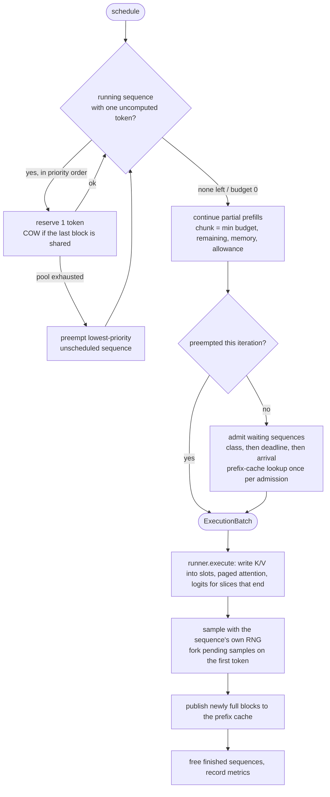

# Scheduler and memory manager

How one iteration of `Engine.step()` is built, what the KV pool looks like while it runs, and which
invariants the tests hold the code to. File references are under `src/paged_kv_serving/engine/`.

## One bookkeeping rule

Every sequence (`sequence.py`) carries `token_ids` (prompt plus everything sampled so far) and
`num_computed_tokens` (the leading tokens whose keys and values are in the KV cache). An iteration
runs `token_ids[num_computed : num_computed + chunk]` at those absolute positions, and produces a
next token exactly when the chunk reaches the end of `token_ids`.

Prefill (a chunk of many), chunked prefill (a chunk of some), decode (a chunk of one) and
recomputation after preemption (a chunk over prompt *and* previously generated tokens) are all the
same operation with different chunk sizes. That is why the scheduler can mix them in one batch.

## The KV pool

```
runner._keys / runner._values : float32[n_layers, num_blocks, block_size, n_heads, head_dim]

sequence A  block_table = [7, 2, 9]        tokens 0..15 -> block 7, 16..31 -> block 2, 32.. -> block 9
sequence B  block_table = [7, 2, 4]        shares A's first 32 tokens (prefix cache or fork)

BlockManager: ref_count[7] = 3 (A, B, prefix cache)   ref_count[9] = 1   free list = FIFO deque
```

- **Allocation** (`blocks.py`) is a FIFO free list with reference counts. `allocate_many` is all or
  nothing. `check_invariants` verifies that the free list holds exactly the zero-count blocks with
  no duplicates and that free plus referenced covers the pool (the leak checker).
- **Copy-on-write**: `prepare_for_write` on a block with more than one owner allocates a fresh
  block, asks the `BlockStore` (the runner) to copy the bytes across all layers, drops the
  caller's reference to the original and returns the new id. `KVCacheManager.reserve` counts the
  copies and the new blocks a write needs *before* touching anything, so a reservation either
  succeeds completely or leaves every table and reference count unchanged.
- **Prefix cache** (`prefix_cache.py`): each *full* block is keyed by
  `h_i = BLAKE2b(h_{i-1} || block_size || tokens of block i)` with `h_0` derived from the caller's
  key id (ADR 0003). The cache holds one reference per entry. Lookup returns the longest matching
  *prefix* of a new prompt's chain (always leaving at least one token to compute, so the request
  still gets logits). Eviction is LRU and skips entries a live sequence is reading.
- **Fork** (`kvcache.py`): the samples of an `n > 1` request share the prompt's blocks by
  reference; each gets a private copy of the partially filled last block on its first write.

## Paged attention

`attention.py` computes causal attention of a slice's queries over the first `context_len` cached
tokens by walking the block table in tiles of `tile_blocks` blocks and folding each tile into a
running result with the online-softmax recurrence (Milakov and Gimelshein, 2018). Masking is by
absolute position, so the same kernel serves a single decode query and a mid-prompt prefill chunk.
The runner (`runner.py`) runs everything that does not depend on history (embedding, QKV,
output projection, feed-forward, logits) once over the flattened token axis of the whole ragged
batch; only attention consults per-sequence block tables.

## One iteration



1. **Decode first.** Every running sequence that has consumed its prompt gets one token, in
   priority order (SLO class, then earliest deadline, then arrival). If a reservation fails, the
   lowest-priority running sequence *not yet scheduled in this iteration* is preempted -- a decoder
   still waiting or a sequence part-way through prefill -- and the reservation is retried. A
   sequence that is the last one standing preempts itself, which releases its blocks for others.
2. **Continue prefills.** Running sequences whose prompt is incomplete take the remaining budget in
   chunks (Sarathi-Serve style chunked prefill, Agrawal et al., OSDI 2024), limited by free plus
   evictable blocks.
3. **Admit.** Waiting sequences join in priority order while budget, running slots and blocks
   (above a small watermark) remain. Admission stops at the first sequence that cannot get even
   one token, so a lower-priority request never jumps a higher-priority one that is waiting for
   memory. Nothing is admitted in an iteration that preempted.

While any higher-class sequence is running or waiting, all lower-class prefill in phases 2 and 3
shares an allowance of `lower_class_prefill_share * max_batched_tokens` tokens (ADR 0005). Decode
is never capped.

## Admission control (before step 1)

`Engine.submit` rejects, before a single block is allocated: prompts or `max_new_tokens` over the
engine limits (400), keys not entitled to the requested SLO class (403), keys over their
concurrency or tokens-per-minute limits (429), a full queue (503) and requests whose deadline the
iteration-counting test says cannot be met (503 with a `Retry-After` computed from the backlog).
The test and its pessimism are described in ADR 0004.

## Cancellation, timeouts and drain

- `Engine.abort` removes every sample of a request from whichever queue holds it and frees its
  blocks immediately. The SSE path calls it from the stream generator's `finally`, as a separate
  task shielded from the cancellation that triggered it (`service.py`): under anyio every await in
  a cancelled scope is cancelled again, so awaiting the abort inline would never take the engine
  lock and the blocks would stay pinned.
- `APP_REQUEST_TIMEOUT_SECONDS` bounds the wall time of every request, streaming or not; a
  request that runs out is aborted the same way (504, or an SSE `error` event).
- On shutdown the lifespan calls `EngineService.drain`: stop admitting (new requests get 503
  `draining`), wait for in-flight requests up to `APP_DRAIN_TIMEOUT_SECONDS`, then stop the loop.

## Invariants and where they are checked

| Invariant | Checked by |
|---|---|
| Reference counts never negative; free list = zero-count blocks, no duplicates; nothing leaks | `BlockManager.check_invariants` after every step in the engine property test and the stateful allocator machine |
| Every sequence reads back exactly the tokens it computed, at the right slots (catches a missed copy-on-write or a block handed out twice) | `tests/property/test_allocator_state.py` (hypothesis stateful) |
| A block registered in the prefix cache never changes content | same stateful machine |
| Paged, chunked, batched, shared, preempted execution gives the logits of a dense recompute | `tests/property/test_engine_equivalence.py`, `tests/property/test_equivalence.py` |
| A preempted request produces the same tokens | `tests/integration/test_engine.py` |
| With an accurate latency model no admitted request misses its deadline | `tests/integration/test_deadlines.py`, `bench/bench_serving.py` |
